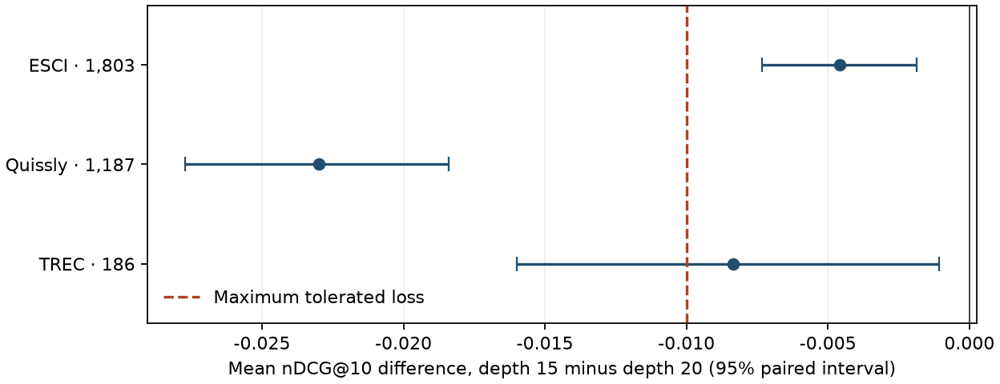

# External validation of constant depth 15

We tested the original policies on two additional retail search benchmarks with no change to model weights or routing thresholds. Query-level intervals below are paired 95% bootstrap intervals. Each test uses the previously specified tolerance of 0.01 nDCG@10. Smaller loss than that threshold must be supported by the lower confidence bound.

| Evaluation | Eligible queries | Fixed 15 | Fixed 20 | Fixed 15 minus 20 [95% interval] | Quality margin |
|---|---:|---:|---:|---|---|
| Original ESCI follow-up | 1,803 | 0.6539 | 0.6585 | −0.0046 [−0.0073, −0.0019] | Passed |
| External Quissly | 1,187 | 0.5952 | 0.6182 | −0.0230 [−0.0277, −0.0184] | Loss exceeds tolerance |
| TREC 2023 Product Search | 186 | 0.7285 | 0.7368 | −0.0084 [−0.0160, −0.0011] | Inconclusive for tolerance |



On Quissly, fixed 15 reduced mean CPU time by 28% compared with fixed 20. Fixed 20 had the highest mean nDCG in every sector. Quissly uses synthetic queries and machine judgments. TREC contributes a separate NIST-judged test in the Amazon product ecosystem. Evaluation is restricted to judged pools in both experiments. Treat cross-dataset differences as transfer results, without pooling raw nDCG across different judgment scales. The external data support checking a depth-15 deployment against target-domain relevance judgments before adopting it.

Both external intervals for fixed 15 minus the frozen post router include zero. These experiments do not establish a general quality advantage over the learned router. CPU times from Quissly exclude queueing; original open-loop response times are reported separately.

[Quissly methods, audit and results](external-retail/REPORT.md) · [TREC methods, audit and results](trec-replication/REPORT.md)

## Repeat the new tests

Use the original environment and frozen assets. If the original experiment was rebuilt by `reproduce.sh`, the generated ONNX files and fitted router are under `reproduction/`. From a fresh checkout, copy `trec-replication/` and `external-retail/` into that completed reproduction directory, change into it, and run:

```bash
python trec-replication/run.py
python trec-replication/audit.py
PYTHON="$(command -v python)" bash external-retail/reproduce.sh
```

To check the published evidence without downloading data or fitting anything, run the two offline audits from the checkout: `python3 trec-replication/audit.py` and `python3 external-retail/verify.py external-retail/results`. A separate Ubuntu replay of the TREC run produced the same decisions as macOS on all 186 queries; the maximum per-query metric difference was below 4 × 10⁻¹⁶. [Cross-platform check](trec-replication/platform-check.json)
