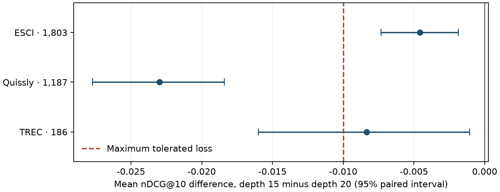

# How many products should a search reranker score?

Scoring 15 products per query beat a learned routing policy on the Amazon ESCI test set. On a second retail benchmark, the same shortcut saved **28% of CPU time** but lost **0.023 nDCG@10**, more than twice the allowed loss. This study measures where that trade-off changes.



### The experiment

BM25 selects up to 20 titles from each judged product pool. A frozen MiniLM cross-encoder reranks them. One policy always scores 15 candidates, another scores all 20, and a learned router decides after the first 10 whether a second batch is worthwhile. The router scores about 15 products per query on ESCI, making constant depth 15 a simple comparison at a similar average cost.

| Evaluation | Queries | Fixed 15 nDCG@10 | Fixed 20 nDCG@10 | Difference, paired 95% interval |
|---|---:|---:|---:|---:|
| Amazon ESCI | 1,803 | 0.6539 | 0.6585 | −0.0046 [−0.0073, −0.0019] |
| Quissly, seven retail sectors | 1,187 | 0.5952 | 0.6182 | −0.0230 [−0.0277, −0.0184] |
| TREC 2023 Product Search | 186 | 0.7285 | 0.7368 | −0.0084 [−0.0160, −0.0011] |

A fixed depth qualifies on quality if the lower confidence bound stays above **−0.01**. Depth 15 passed on ESCI, exceeded the loss limit on Quissly and left the decision unresolved on TREC. Quissly uses synthetic queries and machine judgments. TREC supplies a separate judged test within the Amazon product ecosystem. The depth-15 comparison was added after examining the original ESCI result and specified before evaluating the external datasets. [External validation and per-query evidence](EXTERNAL_VALIDATION.md)

### What latency adds

On an Intel i5-12400 at **26 queries/s**, fixed 15 achieved **207 ms p95** versus **284 ms** for the learned router and **1,331 ms** for fixed 20. These are queue-inclusive response times from the same synthetic arrival traces. They include tokenization, routing and reranking after retrieval. Catalog retrieval and networking are outside the measurement. [CPU experiment and independent reconstruction](REPORT.md) · [Original protocol](PROTOCOL.md)

### Verify or reproduce

Check the published timing records and both external snapshots offline with Python's standard library:

```sh
python3 audit_confirm.py
python3 external-retail/verify.py external-retail/results
python3 trec-replication/audit.py
```

For the full original experiment on Linux, use a Python 3.14 virtual environment:

```sh
python3.14 -m venv .venv
. .venv/bin/activate
pip install -r requirements.lock matplotlib==3.11.2
./reproduce.sh
```

The runner verifies downloads and resumes completed jobs in `reproduction/`. Separate instructions cover both external replays. [External reproduction guide](EXTERNAL_VALIDATION.md) · [Fixed-depth comparator](FIXED_DEPTH.md) · [Training-label sensitivity](LABEL_EFFICIENCY.md)
