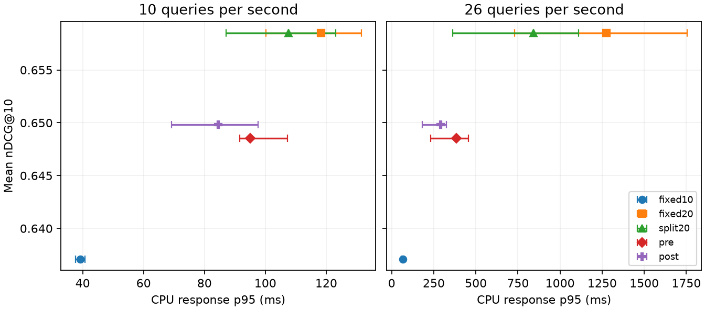
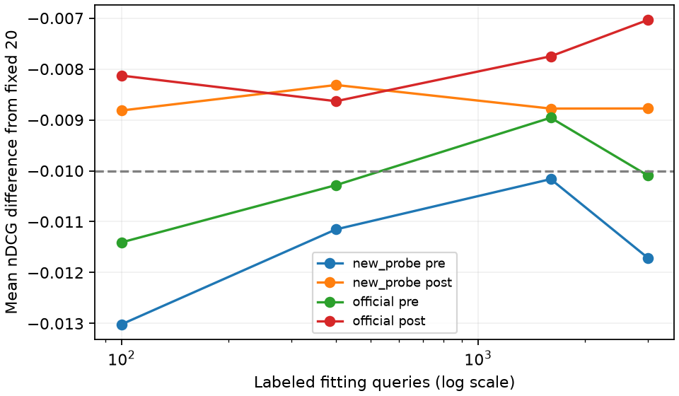
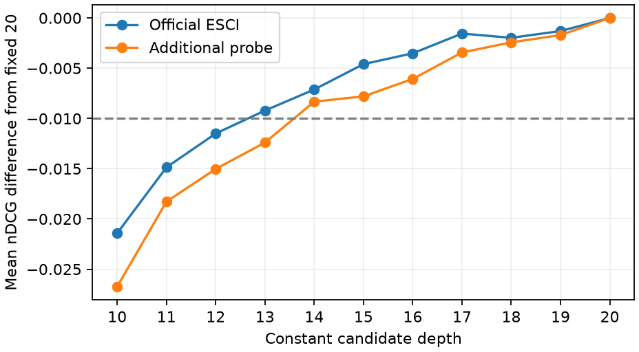

# Can a search engine learn when to score ten more products?

**External validation.** Depth 15 exceeded the allowed quality loss on Quissly; TREC left the margin unresolved. [Results on 1,373 additional queries](EXTERNAL_VALIDATION.md)

On 1,803 held-out Amazon queries, scoring twenty candidates in one batch achieved the highest measured quality among deployable policies. Both learned routers sent about half the queries to depth twenty. Neither met the predeclared quality requirement.

In the subsequent same-budget comparison, a constant depth of 15 achieved 0.6539 nDCG@10 and had lower p95 than the learned post router at both loads (70.9 versus 85.9 ms at 10 queries/s; 207.1 versus 283.7 ms at 26 queries/s). Within this setup, constant depth 15 is the supported operating choice. This control was specified after seeing the original results.

## Quality on the official ESCI test split

| Policy | Mean nDCG@10 | Difference from fixed 20 | Paired 95% interval | Share sent to depth 20 |
|---|---:|---:|---:|---:|
| fixed20 | 0.6585 | +0.0000 | [+0.0000, +0.0000] | 100.0% |
| fixed10 | 0.6371 | -0.0214 | [-0.0268, -0.0162] | 0.0% |
| pre | 0.6486 | -0.0100 | [-0.0137, -0.0065] | 49.9% |
| pre_shuffle | 0.6470 | -0.0116 | [-0.0151, -0.0077] | 49.9% |
| pre_oracle | 0.6884 | +0.0298 | [+0.0272, +0.0326] | 49.9% |
| post | 0.6498 | -0.0087 | [-0.0124, -0.0049] | 49.8% |
| post_shuffle | 0.6496 | -0.0089 | [-0.0127, -0.0050] | 49.8% |
| post_oracle | 0.6884 | +0.0298 | [+0.0272, +0.0326] | 49.8% |

The target required the lower interval bound to exceed −0.01. Each shuffle is one random allocation at the corresponding router’s pair budget. Each oracle selects queries retrospectively using known relevance labels. A deeper rerank can displace a relevant item, so the oracle can outperform fixed 20.

## Does the router pick the right queries?

* pre gained +0.0008 nDCG over the expected value of a uniformly random allocation at the same pair budget (paired bootstrap 95% interval [-0.0019, +0.0034], one-sided permutation p = 0.280).
* post gained +0.0020 nDCG over the expected value of a uniformly random allocation at the same pair budget (paired bootstrap 95% interval [-0.0006, +0.0046], one-sided permutation p = 0.061).

These exploratory diagnostics measure the covariance between the decision to spend more and the resulting change in quality. They do not equate the CPU time of two different batching strategies.

## Measured CPU response time

Median p95 across four traces, in milliseconds. Brackets show the range across traces. Each trace has 240 queries, identical arrival offsets and query order for competing policies. Response time includes queueing. Separate service times are in [the trace summary](results/confirm/latency.csv).

| Policy | 10 queries/s | 26 queries/s |
|---|---:|---:|
| fixed10 | 39.2 [37.6, 40.7] | 67.5 [56.1, 71.6] |
| fixed20 | 118.2 [100.1, 131.5] | 1275.1 [729.4, 1755.3] |
| split20 | 107.6 [87.0, 123.1] | 842.4 [362.3, 1109.6] |
| pre | 94.9 [91.5, 107.3] | 383.7 [232.2, 454.8] |
| post | 84.6 [69.1, 97.7] | 289.6 [183.0, 325.4] |

The pre router chooses a single batch before inference. The post router can issue a second batch after seeing the first ten scores. Split 20 always issues both batches. The fixed baselines use one model call. Measurements used an Intel Core i5-12400 on Ubuntu 26.04.1, six ONNX Runtime intra-op threads and one inter-op thread. Tail times depend on the arrival process, batch shape and CPU.

## Interpretation and scope

For a deployment requiring the declared quality margin, the original adaptive policies did not qualify. The same-budget fixed-depth follow-up below evaluates another deployment option. The label-informed upper bound suggests scope for a better allocation rule, but supplies no deployable way to identify those queries. The Wayfair pilot is exploratory. The ESCI test protocol was frozen separately. Both datasets use judged pools and title-only candidates. Training and official test queries are disjoint under the stated normalization; shared products and semantically similar queries can still occur. Latency excludes retrieval, networking and production contention. Four synthetic traces on one machine characterize this implementation only.

[Frozen protocol](PROTOCOL.md) · [Per-query audit](results/confirm/query_effects.csv) · [Diagnostic estimates](results/confirm/allocation.json)

## Implementation checks

The independent batch-shape replay scored all 1,803 queries with separate batches of ten. It changed 0 post-router decisions. Actual mean nDCG@10 was fixed10 0.63710, fixed20 0.65852, split20 0.65852, pre 0.64855, post 0.64982.

Checking the original data found 0 normalized test queries shared with the training or pilot samples. The full [pool audit](results/confirm/pool_audit.json) also counts zero-gain queries, conflicting labels and spelling variants.

## Earlier transfer pilot

* always20 on 271 held-out WANDS queries: nDCG@10 0.7703, CPU service p95 35.9 ms.
* human-200 on 271 held-out WANDS queries: nDCG@10 0.7601, CPU service p95 31.1 ms.

The transfer pilot used an unloaded replay and adapted the human-label router on 200 separate WANDS queries. Its service p95 and the later queue-inclusive response p95 describe different experiments.

The original WANDS labels contain 14 conflicting query–product pairs. The reproducible rule averages distinct gains per pair.

The change affected 5 eligible queries. Fixed 20 moved from 0.77043 to 0.77033. The adapted router moved from 0.75988 to 0.76006.

At 10 queries/s the post router cut median trace p95 by 28.5%; at 26 queries/s the reduction was 77.3%. Queueing magnifies the difference at high load. These speedups alone do not satisfy the joint quality and latency criterion.

## Independent reconstruction on Ubuntu

A separate working directory rebuilt the datasets, model outputs, routing decisions and all 9,600 timing calls from verified source files. 5 of 5 quality and diagnostic artifacts were numerically identical. The maximum absolute pilot nDCG difference was 0. The trace inputs and route depths matched. Clock measurements can vary.

| Queries/s | Primary fixed 20 / post p95 (ms) | Repeat fixed 20 / post p95 (ms) |
|---|---:|---:|
| 10 | 118.2 / 84.6 | 119.0 / 83.5 |
| 26 | 1275.1 / 289.6 | 1307.3 / 286.4 |

## Does the router need more training labels?

The follow-up scored 2,199 additional query pools and reserved 800 previously unevaluated queries from the official training partition. Each of five seeds sampled nested training sets. All models used the same 200 calibration queries. The table reports the five-seed mean difference from fixed 20 for every training size. This follow-up was designed after opening the official test. [Protocol](LABEL_EFFICIENCY.md) · [All runs and query-bootstrap intervals](results/learning/curve.json)

| Labeled fitting queries | New probe, pre | New probe, post | Official, pre | Official, post |
|---:|---:|---:|---:|---:|
| 100 | -0.0130 | -0.0088 | -0.0114 | -0.0081 |
| 400 | -0.0112 | -0.0083 | -0.0103 | -0.0086 |
| 1600 | -0.0102 | -0.0088 | -0.0090 | -0.0078 |
| 2999 | -0.0117 | -0.0088 | -0.0101 | -0.0070 |

## A fixed-depth comparator at approximately the same pair budget

Fixed 15 scored 0.6539 nDCG@10. Its difference from fixed 20 was -0.0046 (95% paired interval [-0.0073, -0.0019]). Independent depth-15 inference found 0 queries with different nDCG from the prefix scores. On the additional 800-query probe the fixed-15 difference from fixed 20 was -0.0078.

| Policy | Median response p95 at 10 queries/s (ms) | At 26 queries/s (ms) |
|---|---:|---:|
| fixed15 | 70.9 | 207.1 |
| fixed20 | 117.7 | 1331.1 |
| post | 85.9 | 283.7 |

The post router minus fixed 15 was -0.0041 nDCG (95% paired interval [-0.0079, -0.0006]). Constant depth 15 met the quality margin. Its latency reductions versus fixed 20 were 39.8% and 84.4%, respectively. This follow-up used 5,760 further timed requests and was designed after the original test. [Prespecified comparator](FIXED_DEPTH.md) · [Measured traces](results/fixed-depth/latency.json)

